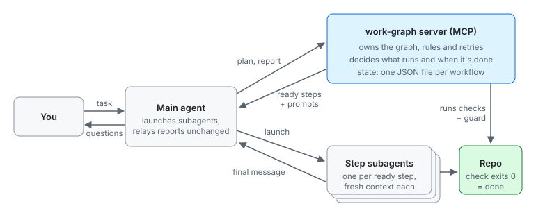
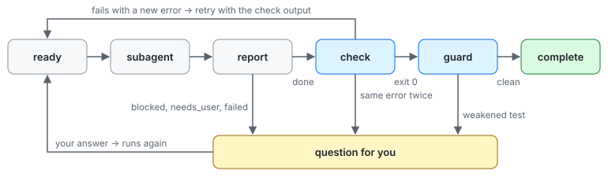

*A run partway through, drawn like work-graph's `view` tool draws it, with most of the 60 migrations folded into one box. Green steps passed their check. Blue is running. Orange is running again after a failed check. Red is waiting on me. Gray is waiting on other steps.*

I keep giving coding agents tasks that are really dozens of tasks. Something like "move all 60 skills to the new layout, one branch each, with every eval passing. Then turn on six stricter lint rules and remove the old exemptions." One agent can start that, but it loses track along the way. It says it's done after 40 skills. It gets a failing eval to pass by changing the eval, or it quiets a lint rule by adding one more exemption.

Subagents help, since each one starts fresh. But something still has to decide what runs next, when a step is really done, and when to ask me. I wanted code making those calls, not the model, so I wrote [work-graph](https://github.com/altinokdarici/work-graph), a small plugin for Copilot CLI and Claude Code.

The graph above is a run like that. Each box is a step with its own subagent and usually its own check, like `npm run evals -- <skill>` for a migration. Arrows mean "waits for". Eight steps run at a time. `migrate-23` failed its eval and is on its second try. `migrate-41` hit a decision it shouldn't make alone, so it's waiting for me. `lint-audit` counted violations and added one fix step per rule, so `enable-rules` waits for those. It waits for the migrations too, so new skill files get linted. No box is green because an agent said so.

## How it fits together

There are three parts:

- **An MCP server** with a few short tools: `plan`, `next`, `report`, `answer`, `add_step`, `resume`, `status` and `view`. It holds the graph, the rules and the checks.
- **A prompt hook** that brings up open questions on each message.
- **A skill** that teaches the main agent to plan: small steps, a check for each, separate worktrees for parallel branches.

The main agent calls `plan` with a goal, steps and dependencies. Each reply lists the steps that are ready, with a full prompt for each. The main agent starts them as subagents and passes each one's last message to `report` as is.



The graph itself is [`@altinok/p-graph`](https://www.npmjs.com/package/@altinok/p-graph), a small library of mine for graphs that can change while they run.

## Reports and checks

Every step ends with a small JSON report:

```ts
{ status: "done" | "blocked" | "needs_user" | "failed",
  summary: string,
  question?: string,
  newTasks?: { id, title, instructions, check?, dependsOn? }[] }
```

A step is finished only when it reports `done` and its check passes. The server runs the check itself, from the repo root.

Reports can add work but never remove it. There's no tool to delete a step or mark one finished by hand. When a review finds problems, it lists the fixes as new tasks, and anything waiting on the review now waits on the fixes too. The graph can grow during a run, but it can't shrink.

The last step, `goal`, waits for everything else. Its agent checks the real files and branches instead of trusting summaries, and can add steps if something is missing.

## Checks written early, enforced late

My guess is that models are most honest at the start of a task, when the context is small. Late in a run, with a test that keeps failing and a full context, cutting a corner gets tempting. So checks are written during planning, and the server holds every step to them later.

But `npm test` still passes if a step adds `it.skip` to the failing test. So when a step starts, the server saves a git snapshot with `git stash create`. When the check passes, it compares against that snapshot and looks for:

- new `skip`, `only` or `todo` markers
- deleted test files
- edits to files named in the step's check or the goal's check
- changes to the npm scripts those checks run

Any of these turns the step into a question for me. It's simple pattern matching, so it won't catch a loosened assertion. When the workflow finishes, it also lists what the early checks didn't cover, like steps added mid-run whose checks were written late.

## Retrying without a retry count

I didn't want a fixed "retry 3 times" rule. If a step keeps failing in new ways, it's probably making progress. If it fails the same way twice, it's stuck. To tell the two apart, the server strips the noise from the error first:

```ts
export function normalizeError(text: string): string {
  return text
    .replace(/\x1b\[[0-9;]*[A-Za-z]/g, "") // ANSI colors
    .replace(/\d+/g, "#")                   // line numbers, timings, PIDs
    .replace(/\s+/g, " ")
    .trim();
}
```

If the cleaned-up error matches the last one, the step becomes a question for me. If it's new, the step runs again with the check output in its prompt.



## Surviving crashes

Each workflow is one JSON file, and every change is tried on a copy first, so a bad edit never touches the real graph. If a session dies, `resume` puts running steps back in the queue with a new attempt number. A late report from the old subagent has the old number and gets ignored.

## What went wrong

**The first version was built the wrong way.** v0.1 was a CLI extension that ran the steps itself, and it didn't load in ACP hosts. In v0.2 I moved the rules into an MCP server and had the main agent start the subagents. The rules didn't change at all, which told me I'd split things in the right place.

**Two ways to say where a check runs.** I had the plugin fix five of its own issues in parallel, one worktree each. All five fixes were right, and all five checks failed. The plan set a working directory and also put `cd ../worktrees/<name>` in each check, so the path was doubled. Now checks always run from the repo root.

**The main agent answered its own questions.** Those five stuck steps became questions. While I was away, the main agent made a symlink so the doubled path existed, then answered all five itself. "Only the user answers" was just a line in a prompt. I couldn't block it cleanly, so I made it visible: a changed check gets a ⚠ and shows up in the final summary. Nothing can change the goal check.

## What I learned

- Let code decide when something is done. A command that passes or fails beats a sentence describing done.
- Only let agents add to the plan. Most corner-cutting I saw was removing things.
- If you can't enforce a rule, make breaking it visible, and keep one check the model can't touch.
- Test the orchestration with a fake agent. 37 small tests with scripted reports found more bugs than real runs did.

## What's next

Next up are check timeouts and a cap on total rounds. After that, a small eval suite: sandbox repos with known broken items, comparing work-graph against plain subagents.

The code is on GitHub at [altinokdarici/work-graph](https://github.com/altinokdarici/work-graph) under the MIT license. It installs as a plugin for Copilot CLI and Claude Code.
